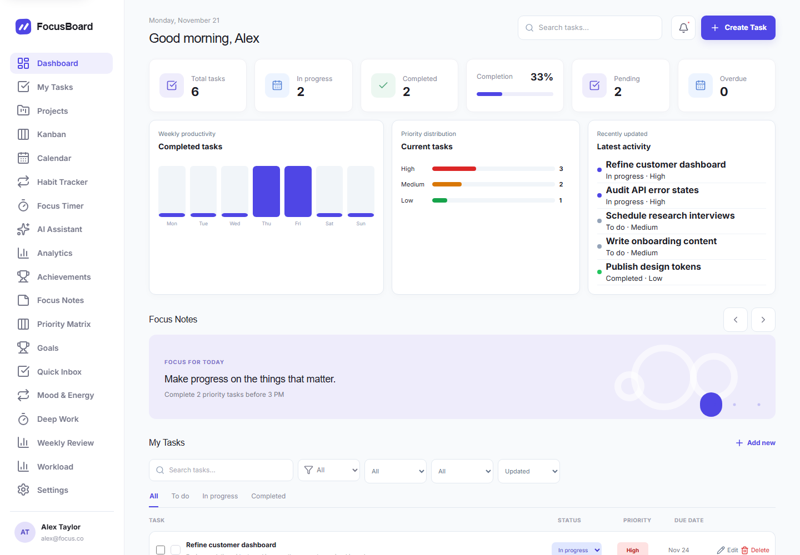
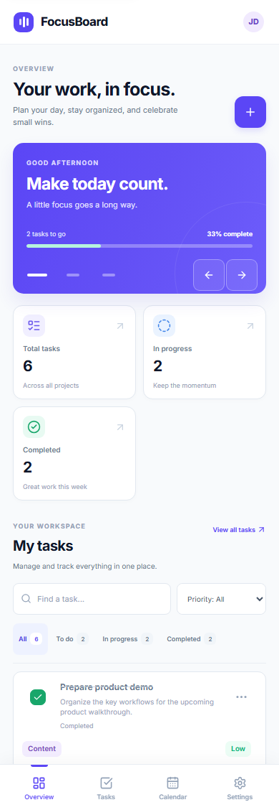

# FocusBoard

<p align="center">
  <strong>A calmer way to plan, track, and finish your work.</strong>
  <br />
  A responsive, single-user task dashboard built with React, designed around clear priorities and immediate feedback.
</p>

<p align="center">
  <a href="https://focusboard-dashboard-tan.vercel.app/">
    
  </a>
  
  
  
</p>

<p align="center">
  <a href="https://github.com/Appireddy-Hemanth/mobile-Application">Source repository</a>
  ·
  <a href="https://focusboard-dashboard-tan.vercel.app/">Live application</a>
</p>

## Overview

FocusBoard helps one person organize a small workload without the overhead of a backend or account system. The dashboard combines task management, calculated progress, responsive navigation, and a three-slide **Focus Notes** carousel. Task changes update the interface immediately and persist in the current browser.

## Product preview

### Desktop · 1440 × 1000



### Mobile · 390 × 1128

<p align="center">
  
</p>

## Features

- **Task management:** Create and edit tasks, validate required titles, and delete tasks with confirmation.
- **Fast completion:** Mark a task complete or reopen it with one click. Choose **To do**, **In progress**, or **Completed** in the task editor.
- **Combined task discovery:** Search task titles case-insensitively and combine search with status tabs and priority filtering.
- **Live dashboard metrics:** Total, in-progress, completed, pending, and completion-percentage values are derived from the task state. Carousel progress updates with the same completion percentage.
- **Focus Notes carousel:** Three slides with previous/next buttons, active indicators, and keyboard navigation.
- **Persistent workspace:** Task edits are saved in `localStorage` and restored after refresh. Six sample tasks are used only when there is no saved task list.
- **Accessible interactions:** Semantic controls, visible keyboard focus, labeled inputs, dialog focus management, and Escape-to-close behavior.

## Responsive design

The layout is tuned for the supplied reference widths:

| Viewport | Layout |
| --- | --- |
| **1440px desktop** | 240px workspace sidebar, breadcrumb header, three-column statistics, and task rows |
| **768px tablet** | Compact navigation and fluid dashboard sections |
| **390px mobile** | Mobile header, two-column statistics, stacked task cards, and fixed bottom navigation |

The task dialog adapts to narrow screens without horizontal scrolling. The bundled reference screenshots are captured at 1440 × 1000 and 390 × 1128.

## Navigation scope

| Path | Behavior |
| --- | --- |
| `/` | Dashboard overview |
| `/tasks` | Dashboard; the My tasks navigation takes you to the task section |
| `/calendar` | Scope-aligned placeholder |
| `/settings` | Scope-aligned placeholder |

Calendar and Settings remain placeholders rather than additional assessment screens. `vercel.json` rewrites application routes to the Vite entry point so client-side navigation works on refresh.

## Tech stack

- **React 19** with JavaScript and JSDoc
- **Vite 8** for development and production builds
- **Tailwind CSS 4** Vite integration, with focused component styling in CSS
- **Lucide React** icons
- **React Context + `useReducer`** for task state
- **Vitest** and **Testing Library** for interaction and persistence tests

## State and data flow

`TaskProvider` makes the reducer-backed task state available to the dashboard through React Context. Task actions produce new state rather than mutating existing task objects. Counts, filtered results, and completion percentage are derived from that shared state, so task rows, statistics, and Focus Notes stay in sync.

```text
Task controls
    ↓
Task reducer → React Context → task rows, filters, statistics, carousel progress
    ↓
localStorage persistence
```

The `focusboard_tasks` key is initialized with the six sample tasks only when the key is absent. A saved empty list stays empty, and invalid saved data is not silently replaced with samples. The completion percentage is calculated as completed tasks divided by total tasks; it is `0%` when there are no tasks.

## Getting started

### Requirements

- Node.js **20.19+** or **22.12+**
- npm

### Install and run

```bash
git clone https://github.com/Appireddy-Hemanth/mobile-Application.git
cd mobile-Application
npm install
npm run dev
```

Open the local URL printed by Vite (by default, `http://localhost:5173`).

### Available scripts

| Command | Description |
| --- | --- |
| `npm run dev` | Start the local Vite development server |
| `npm test` | Run the Vitest suite |
| `npm run test:watch` | Run tests in watch mode |
| `npm run lint` | Run Oxlint |
| `npm run build` | Create the production bundle in `dist/` |
| `npm run preview` | Preview the production build locally |

## Project structure

```text
src/
├── App.jsx                 App shell and route-level composition
├── components/             Task controls, dialogs, cards, and Focus Notes
├── context/                Task context and derived dashboard state
├── data/                   Initial tasks and carousel copy
├── hooks/                  Reducer-backed task state and persistence
├── pages/                  Dashboard and view components
└── test/                   Dashboard and persistence tests
screenshots/                Desktop and mobile README screenshots
```

## Deployment

The public demo is hosted on Vercel:

**[focusboard-dashboard-tan.vercel.app](https://focusboard-dashboard-tan.vercel.app/)**

The source is available in the **[GitHub repository](https://github.com/Appireddy-Hemanth/mobile-Application)**. To deploy your own copy, import the repository into Vercel and use the standard Vite build command, `npm run build`, with `dist` as the output directory.

## Data and limitations

- This is a frontend-only, single-user project; it has no API, login, or cloud synchronization.
- Tasks and preferences belong to the current browser. Clearing site data removes the saved workspace.
- The sample tasks appear only when no saved task list exists.
- Calendar and Settings are intentionally scoped placeholders.
- The carousel is user-controlled; automatic rotation is not enabled.

## AI usage

AI tools and representative prompts used during development are disclosed in [AI_USAGE.md](./AI_USAGE.md).
